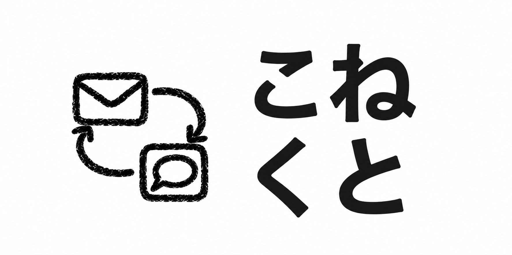

<p align="center">
  
</p>

# こねくと

**誰から届いて、誰に返すかを こねくと ひとつで。**

LINE公式アカウントの1対1メッセージとSlack BotのDMを、同じ受信箱で管理・返信するWebアプリです。PC・スマートフォンに対応しています。

## 課題と着想

主な利用者は、企業の人事担当者や問い合わせ窓口の担当者です。LINE・Slackに連絡が分散すると、アプリを行き来するたびに「誰から届いたか」「誰にまだ返していないか」を確認する負担が生まれます。

こねくとは、連絡先のサービスを変えてもらうのではなく、**担当者側の受信箱をまとめ、返信状況と次の行動を一緒に管理する**という発想で開発しました。例えば、応募者からLINEで届く質問とSlack Botへ届く相談を同じ画面で確認し、すぐ返せない連絡には返信期限を設定できます。

開発に参加していない友人にもHack Day中に実際に使ってもらいました。その意見をもとに予約送信を追加し、スマホで会話を見やすくする入力欄・余白の調整など、利用者目線で機能とUIを改善しました。

## 主な機能

| 機能 | 内容 |
| --- | --- |
| メッセージ・画像 | LINE・Slackの受信／返信、画像の表示・ダウンロード。画像はJPEG・PNG、1枚1MBまで。Enterで送信、Shift＋Enterで改行。 |
| 会話の整理 | すべて・未返信・後で返信・お気に入り、サービス別フィルタ、名前検索。用途別タブの作成・名前変更・並び替え。 |
| 一括送信 | タブ内で選んだ相手に同じ文章または画像を送信。宛先と内容の確認、相手ごとの結果表示に対応。文章と画像は別送信。 |
| 返信忘れ防止 | 「後で返信」の期限を見やすく表示し、期限が早い順に会話を優先表示。指定時刻のリマインダー、最大14日先までの文章の予約送信。「既読にする」で送信せず未返信を解除。 |
| 端末通知 | 新着・返信リマインダーをWeb Pushで通知。設定から有効化・再登録・配信テスト・端末内の表示テスト・停止。通知に人物名や本文は含めません。 |
| 人物・履歴管理 | 表示名の変更、履歴のみの削除、人物・タブ所属・予約を含む完全削除。送受信履歴・画像は30日で自動削除。 |
| 表示設定 | 文字サイズ、ライト／ダークテーマ、タブの移動方法を端末ごとに保存。 |

- 個人のLINEアカウントやSlackユーザーの全DMを取り込むものではありません。同じ人物でもサービスごとに別の連絡先として扱います。

現在は**単一Backend・共有受信箱のMVP**です。ログイン・利用者別の権限管理は未実装です。

## 実現方法と動作確認

- **既存APIで実装：** LINE Messaging APIとSlack API／Socket Modeを利用し、受信したメッセージを共通形式で扱います。サービスごとの処理を`src/providers/`に分離し、共通の受信箱・返信・予約処理につなげています。
- **操作の完結性：** 会話の確認から文章・画像の返信、リマインダー、一括送信まで実装。PC・スマホ幅で主要操作を確認しています。一括送信は宛先確認と相手別の結果表示を備え、結果不明時の自動再送を避けています。
- **検証の再現性：** 2026年10月19日の自動テストは**154件成功**。受信・返信・画像・予約・削除・保存の整合性などを検証しています。実サービスとの接続には認証情報が必要ですが、認証情報なしでもモック3人で主要操作を試せます。

### モックで試せる基本操作

下の起動手順で認証情報を未設定にするか、`DEMO_MODE=true npm start`でBackendを起動してください。

1. モック3人の会話を開き、サービス別フィルタでLINE・Slackを切り替える。
2. 文章や画像を返信し、履歴と「返信済み」への更新を確認する。
3. 「後で返信」の日時や予約送信を設定し、会話内の予定表示を確認する。
4. 「デモ」タブから宛先を選び、一括送信の確認画面と相手別の結果を見る。

モックの送信は外部サービスへ送られません。テストの実行方法は[データ・検証](#データ検証)に記載しています。

## 今後の展望

将来は、**企業が利用する社内SNSと、LINEなどの外部SNSをつなぐ連携システム**を提供したいと考えています。人事・問い合わせ担当者が社内の業務画面から外部の連絡を確認・返信でき、サービスを行き来する負担を減らすことを目指します。

社内SNSとの連携は未実装です。まずはAPI連携が可能な社内SNSを対象とし、社内認証・部署別の権限管理・操作記録に加え、社内だけの相談と外部への返信を分離する設計を検討します。機密情報を外部へ誤送信しない仕組みを整えたうえで、接続先を広げる方針です。

Microsoft Teams・Instagram・Discordへの接続も今後の候補であり、現時点では未実装です。

## 起動方法

### 1. 準備

Node.js 22以上とnpmが必要です。

```sh
npm ci
npm ci --prefix frontend
cp .env.example .env
```

**LINE・Slackの認証情報とデモの実データはリポジトリに含めていません。** Hack Dayのデモ環境では`.env`で設定しています。認証情報をすべて未設定で起動すると、モック3人のデモが表示されます。会話に「これはモックアカウントです。」と明記し、返信・画像送信・タブ整理などを試せます。実際の送受信には各サービスの設定が必要です。

デモの送信は外部へ送らず、`data/demo/`に保存します。実データとは別管理です。`DEMO_MODE=true npm start`で明示的にデモ起動、`DEMO_MODE=false npm start`で自動デモを無効化できます。デモの人物を削除しても再起動では復元しません。

| 環境変数 | 用途 |
| --- | --- |
| `LINE_CHANNEL_ACCESS_TOKEN` / `LINE_CHANNEL_SECRET` | LINEの送受信・署名検証 |
| `SLACK_BOT_TOKEN` / `SLACK_APP_TOKEN` | Slack Bot・Socket Mode |
| `PUBLIC_BASE_URL` | LINE画像送信に必要なHTTPS公開URLのルート（例：`https://example.ngrok-free.dev`） |

SlackはSocket Modeを有効にし、`message.im`を購読します。Botには`chat:write`・`im:history`・`users:read`、画像受信に`files:read`、画像送信に`files:write`が必要です。App Tokenには`connections:write`を設定します。権限を追加したらワークスペースへ再インストールしてください。

### 2. ローカルで起動

別々のターミナルで実行します。

```sh
npm start                         # Backend：3000・3001
npm run dev --prefix frontend      # Frontend：http://127.0.0.1:5173/
```

### 3. スマホ・HTTPSで利用

Backendを起動した状態で、以下を別々のターミナルで実行します。ホスト名は実際のngrok URLに置き換えてください。

```sh
npm run build --prefix frontend
PWA_PUBLIC_HOST=example.ngrok-free.dev npm run preview --prefix frontend
```

```sh
ngrok http http://127.0.0.1:5174
```

- スマホではngrokのHTTPS URLを開きます。
- LINE DevelopersのWebhook URLは`https://example.ngrok-free.dev/webhooks/line`に設定します。
- iPhoneの端末通知はiOS 16.4以降で、ホーム画面に追加したこねくとから許可してください。PCは対応ブラウザで許可します。
- 通知・予約送信にはBackendの稼働が必要です。ngrokで配信する場合はngrokも起動しておきます。
- 通知が届かない場合は「通知を再登録」を試してください。「端末内の表示テスト」では、ネットワークを通さずブラウザ・OS側の通知表示を確認できます。
- Frontendの変更はdevでは通常自動反映されます。previewでは再ビルド後にページを再読み込みしてください。Backendや`.env`の変更後はBackendを再起動します。

## 動作の詳細・制約

- 削除はこねくと内が対象で、LINE・Slack側の履歴は削除しません。完全削除した相手も、新着を受信すると再登録されます。
- 予約送信にはBackendの稼働が必要です。停止中に予定時刻を過ぎた予約は、再起動後に自動送信しません。
- 会話一覧は、未完了の「後で返信」の期限が早い順です。期限超過も含めて日時の昇順に並び、期限未設定の会話は後に表示します。同じ期限・期限未設定同士は、お気に入り→新着順→連絡先ID順です。返信・既読・取消でリマインダーが終了すると通常の順序へ戻ります。
- 一括送信中は画面を開いたままにしてください。送信結果が不明な場合は自動再送しません。

## 使用技術・構成

- **Backend：** Node.js 22以上、JavaScript、Express、`@slack/bolt`、dotenv、web-push。
- **Frontend：** React、Vite、lucide-react、CSS、Service Worker。
- **外部連携：** LINE Messaging API、Slack API／Socket Mode、Web Push、デモ公開用のngrok。
- **保存：** ローカルJSON。メッセージをサービス・人物別、画像をサービス別に分け、管理情報を`data/store.json`へ保存。
- **軽量化：** 会話別メッセージMap、最終メッセージのID参照、画面非表示中の定期取得の休止。
- **デモ機能：** 認証情報なしでもモック3人で動作確認できます。返信・画像送信は外部へ送らず、デモ専用の`data/demo/`へ保存します。

外部サービス固有の処理は`src/providers/`、共通API・保存処理は`src/`、画面は`frontend/`に分離しています。

## セキュリティ・バイ・デザイン

安全な表示・受信検証・保存の整合性確認を設計に組み込んでいます。

- **XSS対策：** 本文や名前をReactでテキストとして表示。画像URLの形式制限と公開プレビューのCSPを設定。
- **受信検証：** LINE WebhookのHMAC-SHA256署名検証、重複受信の抑制、Bot自身のイベント除外。
- **保存の整合性：** 人物別メッセージJSONをSHA-256チェックサムと参照関係で検証。不一致・欠損時は空データで上書きせず起動を中止。管理情報も書き換えられた場合の真正性を保証するものではありません。
- **秘密情報の分離：** 認証情報・実データ・通知用秘密鍵はGit管理外へ保存。TokenやSecretをFrontend・エラーログへ含めません。

## データ・検証

`data/`はGit管理外です。通知先とVAPID鍵は`data/push.json`に自動保存し、再起動後も保持します。バックアップはBackendを停止して`data/`全体を保存してください。

```sh
node --test tests/*.test.js frontend/tests/*.test.js
npm run build --prefix frontend
```

詳しい手順：[デモ・接続設定](docs/demo.md)／[保存形式・復旧](docs/storage.md)／[PWA](docs/pwa.md)
